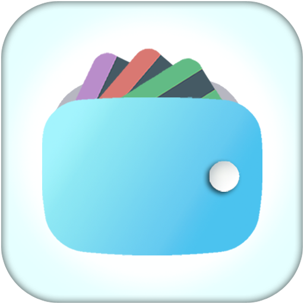
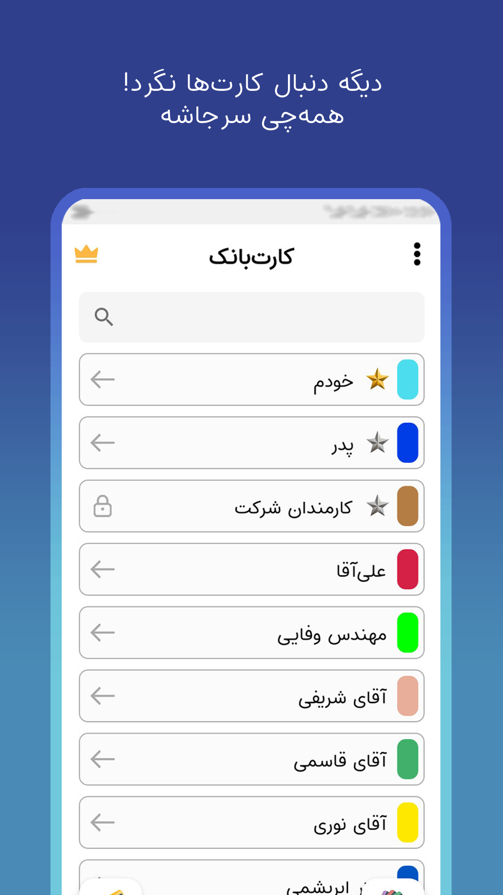
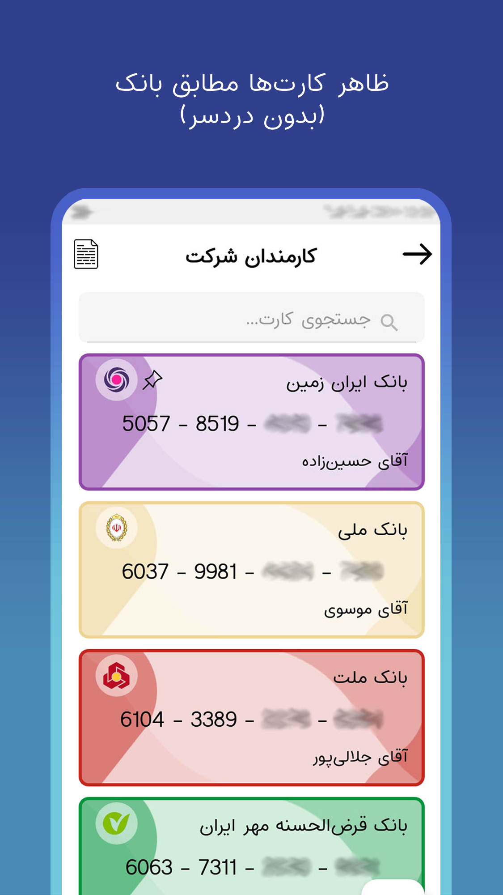
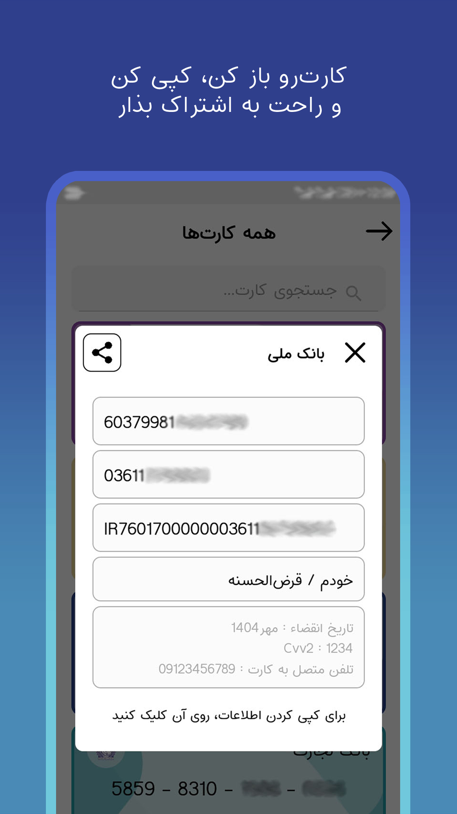
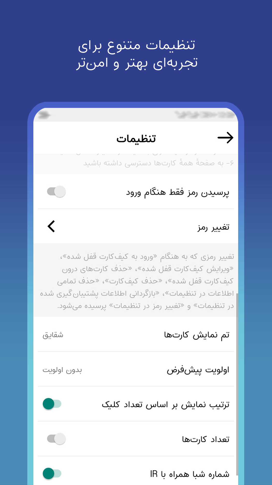

<!-- Profile README for https://github.com/khoshghalb2c -->

<h1 align="center">Hi, I'm Abolfazl 👋</h1>

<h3 align="center">
  Android &amp; Web Developer | Computer Engineering Student
</h3>

  
  

  
  
  
  
  

---

## 🌱 About Me

I started programming in 2015 with QBasic, moved on to web development
(HTML, CSS, JavaScript), and entered backend development in 2017 with
PHP and MySQL. Since 2021, my main focus has been **Android application
development** with Java and Android Studio.

Across all my projects I prioritize **quality, optimization, and user experience**.
My vision is to build practical software that makes users' lives easier and more efficient.

- 🎓 Computer Engineering student at Shahid Montazeri Technical and Vocational University (since September 2025)
- 📱 Android developer: Java, Kotlin, XML, SQLite, REST APIs
- 🌐 Full-stack web: PHP, MySQL, JavaScript, jQuery, Bootstrap 5
- 🎮 Game prototypes with Unity and C#
- 🏆 Three-time first-place winner in programming, game development, and Android app design competitions
- 🚀 Owner of the full product lifecycle, from idea to publishing and post-launch support

---

## 🧰 Technologies &amp; Tools

### 📱 Mobile Development

  
  
  
  
  

### 🌐 Web Development

  

### 🎮 Game Development

  

### 💻 Other Languages &amp; Runtimes

  

### 🛠️ Development Tools

  

---

## 🚀 Featured Project

  

<h3 align="center">CardBank: Secure Bank Card Manager</h3>

  <i>Keep your card numbers, account numbers, and IBANs organized, searchable, and always at hand.</i>

  
  

  
  
  

  
  
  
  

**Role:** Sole Developer &amp; Product Owner 
**Stack:** Android (Java/Kotlin), SQLite, XML, Material Design

- 🔐 Designed a complete security layer: PIN lock, encryption, and backup/restore
- ⚡ Built a high-performance search algorithm that filters thousands of cards in milliseconds
- 📋 Stores card numbers, account numbers, IBANs, and notes, with one-tap copy and easy sharing
- 🎨 Added customizable theming (dark/light mode and color accents) based on user behavior
- 💬 Collected user feedback, prioritized requests, and shipped regular updates
- 🔁 Owned the entire lifecycle from ideation to publishing and post-launch support

---

## 🏆 Achievements &amp; Awards

| 🥇 Place | Competition | Focus | Organizer | Date |
|:--:|:--|:--|:--|:--:|
| 1st | **ACM Programming Contest** | C++ Programming | Farhikhtegan Javan National Student Competition, Science &amp; Research University, Tehran | May 2023 |
| 1st | **Game Development Competition** | C# with Unity Game Engine | Kibord Events, Hamrah Academy, Shahid Beheshti University, Tehran | Feb 2024 |
| 1st | **Android App Design Competition** | Java with Android Studio | Farhikhtegan Javan National Student Competition, Science &amp; Research University, Tehran | May 2024 |

---

## 🎓 Education

**B.Sc. in Computer Engineering** 
Shahid Montazeri Technical and Vocational University, Mashhad 
📅 September 2025 – present

---

## 🌍 Languages

- 🇮🇷 Persian (Native)
- 🇬🇧 English (Intermediate)

---

## 🤝 Let's Connect

I'm open to collaboration, new ideas, and interesting Android and web projects.

  
  
  
  

  <i>Building practical, elegant, and efficient software, one release at a time. 🚀</i>

